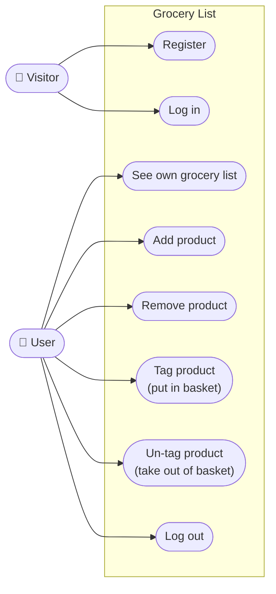
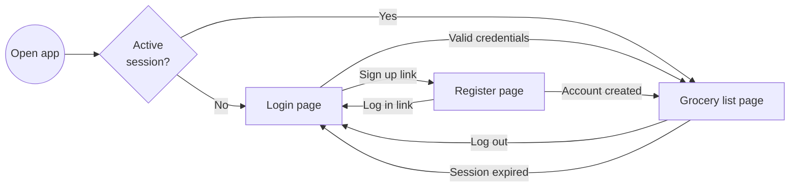
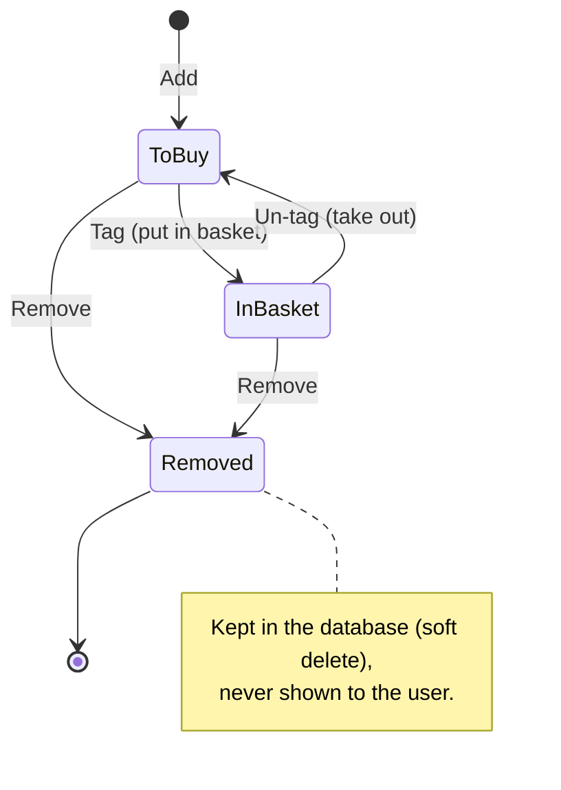

# 1. Functional Design

This document describes **what** the Grocery List application does, from the point of view of its users.
The [architecture](02-architecture.md) and [technical design](03-technical-design.md) documents describe
**how** it is built.

## 1.1 Purpose and scope

Grocery List is a demo web application where each user keeps a personal grocery list. While shopping,
the user tags the products that are already in the basket, so it is always clear what is still missing.

The data lives in the backend. The frontend is only used for user interaction, so new frontends
(for example, a mobile app) can be built on top of the same backend.

**In scope**

- User registration, login and logout.
- One private grocery list per user.
- Adding, removing, tagging and un-tagging products.

**Out of scope (for this version)**

- Quantities, categories or notes per product.
- Several lists per user or shared lists.
- Restoring removed products (the data is kept, see [US5](#us5---remove-a-product)).
- Password recovery and user profile management.

## 1.2 Actors

| Actor | Description |
|---|---|
| Visitor | A person without an active session. Can only register or log in. |
| User | A registered person with an active session. Manages their own grocery list. |

## 1.3 Use cases

## 1.4 User stories and acceptance criteria

The nine user stories come from the assessment. The acceptance criteria describe the implemented
behavior and include the answers received to the clarification questions (see [1.7](#17-clarifications)).

### US1 - Register

> A user can register with a username, full name, and password.

- The username is **required**, has **3 to 50 characters** and only contains letters, numbers,
  dots, hyphens and underscores.
- The username is **unique** and the comparison is **case-insensitive** (`Diana` and `diana` are the
  same user).
- The full name is **required** and has at most **100 characters**.
- The password is **required** and has **8 to 100 characters**. No other complexity rules are applied
  ("keep it as simple as possible").
- The form asks for the password twice and both values must match.
- Leading and trailing spaces are removed from the username and the full name (not from the password).
- If the username is taken, the error is shown next to the username field.
- After a successful registration the user is logged in automatically and sees their (empty) list.

### US2 - Log in

> A user can login with the registered username and password.

- Username and password are required.
- If the username does not exist **or** the password is wrong, the same message is shown:
  *"Invalid username or password."* This avoids revealing which usernames exist.
- After a successful login the user sees their grocery list.
- A user who is already logged in and opens the login or register page is sent to the list.

### US3 - See the grocery list

> Users can see their grocery list. Do not allow to load products of other users.

- Each user has exactly **one** list and only sees **their own** products.
- The list is split into two sections: **To buy** and **In the basket**, with a summary such as
  *"1 of 3 in the basket"*.
- Products are shown in the order they were added.
- Trying to access a product of another user behaves exactly as if the product did not exist.

### US4 - Add a product

> A user can add a product to their grocery list.

- A product is defined only by its **name** (required, at most **100 characters**).
- **Duplicate names are allowed.**
- A new product starts in the **To buy** section.
- After adding, the input is cleared and keeps the focus, so several products can be added quickly.

### US5 - Remove a product

> A user can remove a product from their grocery list.

- The product disappears from the list immediately.
- The product is **not physically deleted**: it is kept in the database
  marked as removed (soft delete). This was confirmed as the preferred option, to allow a future
  recycle bin with restore options.
- A removed product cannot be tagged, un-tagged or removed again.

### US6 - Tag a product

> A user can tag a product to their grocery list (like while shopping, buying in store and putting it in basket).

- Tagging is a **single status**: the product is *in the basket* or not. There are no custom labels.
- The **Put in basket** button moves the product to the **In the basket** section, where it is shown
  with a green background, crossed out and with an *In basket* badge.

### US7 - Un-tag a product

> A user can un-tag a product from their grocery list (like while shopping, putting it back from basket to display).

- The **Take out** button moves the product back to the **To buy** section.

### US8 - Log out

> Users can log out.

- The **Log out** button ends the session and shows the login page.
- The session token is discarded by the client. The backend is stateless, so there is nothing to
  close on the server.

### US9 - No session, no products

> If there is no active session, the user cannot see any product. Logins are mandatory.

- Without a session, any page of the application redirects to the login page.
- Every product endpoint of the API rejects requests without a valid token (`401 Unauthorized`).
- A session lasts **60 minutes**. When it expires, the next action sends the user to the login page.
- The session survives a page reload, but it is discarded when the browser tab is closed.

## 1.5 Screens and navigation

| Screen | Content |
|---|---|
| Login | Username, password, link to register. |
| Register | Username, full name, password, password confirmation, link to login. |
| Grocery list | Header with the user's name and **Log out**; form to add a product; sections **To buy** and **In the basket**; each product has **Put in basket** / **Take out** and **Remove**. |

Errors are shown next to the related field (validation) or as a message at the top of the form or list
(server or connection errors). Buttons are disabled while a request is running, to avoid duplicate actions.

## 1.6 Product life cycle

## 1.7 Clarifications

Questions were sent before the analysis. The answers received are applied in this design.

| # | Question | Answer | Decision |
|---|---|---|---|
| 1 | Is tagging a single status or custom labels? | A single status: *in basket*. | `IsTagged` flag per product. |
| 2 | Is a product only a name? Quantities, notes, category? Duplicates? | Only the name for now; quantities would be a good next step. Duplicates are allowed. | Name only, no unique constraint. Quantities are listed in the [roadmap](04-handover.md). |
| 3 | One list per user or several? | A user can only see their own list. | One list per user (the list is the set of the user's products). |
| 4 | Permanent delete or soft delete? | Soft delete, to allow a future recycle bin. | `DeletedAt` column and a global query filter. |
| 5 | Is JWT acceptable? Server-side logout? Session duration? | JWT is fine. The expiration is up to the developer. | JWT valid for 60 minutes; logout discards the token on the client. |
| 6 | Password and username rules? | Keep it as simple as possible. The username must be unique. | Minimum lengths only; unique, case-insensitive username. |
| 7 | Is a Git repository with instructions enough, or a public deployment? | A public deployment is a nice plus, not mandatory. | Git repository with step-by-step instructions to run locally. |

## 1.8 Assumptions

- The application is used in English and by one person per account.
- Dates are stored in UTC.
- The user interface must work on desktop and mobile screen sizes, but it is not a native mobile app.
- Visual design is kept simple and clean; the focus is on a clear, usable flow.
