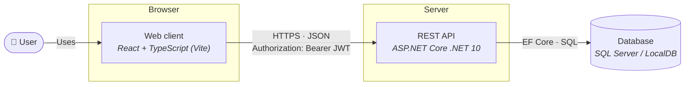
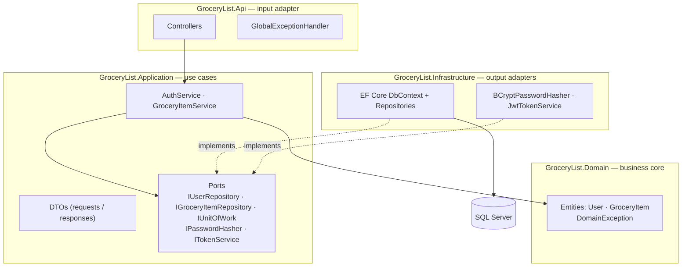
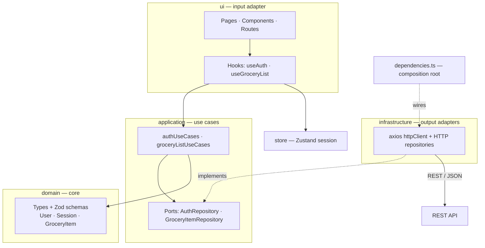
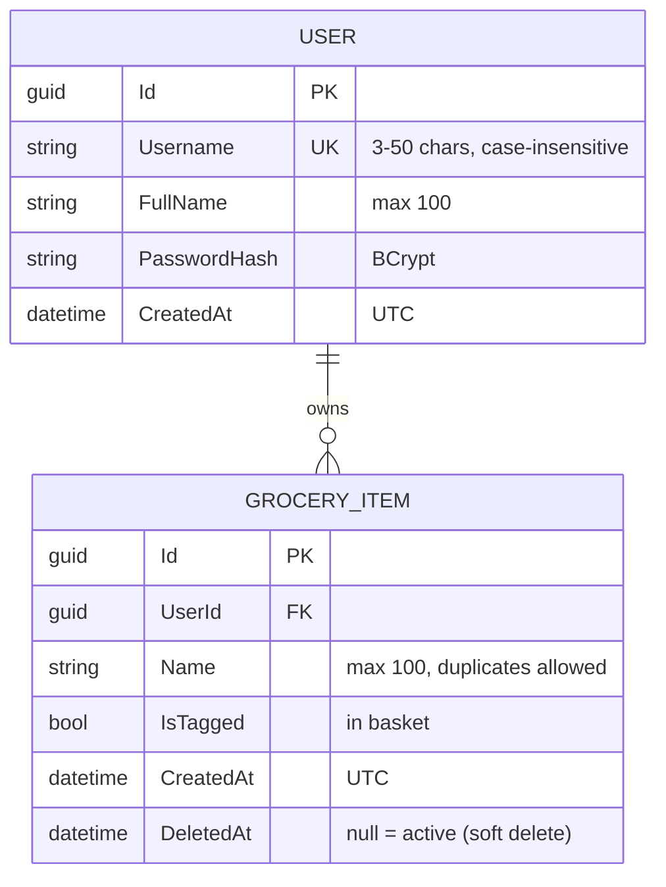
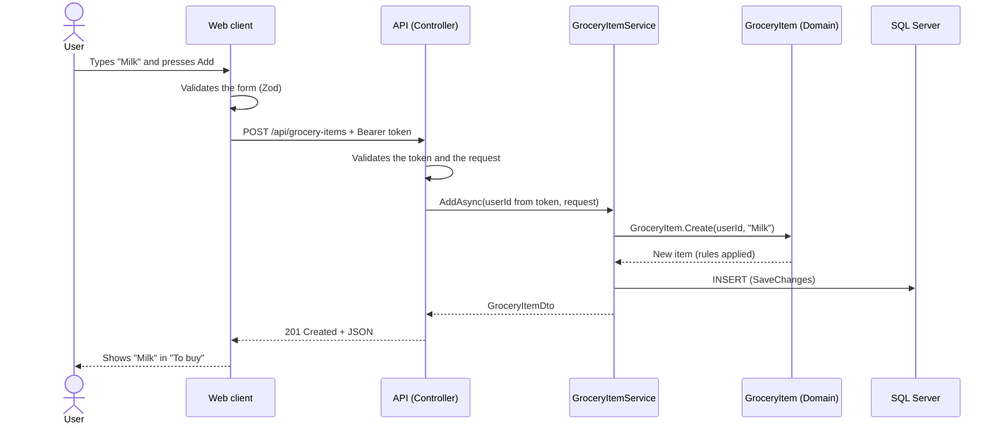

# 2. Architecture and Logical Design

This document shows how the solution is organized: the system as a whole, the internal structure of
each part, and the logical data model.

## 2.1 System architecture

The solution has three independent parts. They only communicate through a REST/JSON API, so a new
client (for example, a mobile app) can use the same backend.

| Part | Responsibility |
|---|---|
| Web client | User interface only. Validates the forms, keeps the session token and calls the API. It holds no business data. |
| REST API | Business rules, authentication (JWT) and data access. It is stateless: every request carries its token. |
| Database | Stores users and grocery items. |

## 2.2 Software architecture

Both the backend and the frontend use a **hexagonal architecture (ports and adapters)**. The business
core is in the center and does not depend on frameworks, the database or HTTP. The outer layers depend
on the inner ones, never the other way around.

### Backend

| Project | Contains | Depends on |
|---|---|---|
| `Domain` | Entities and their rules | Nothing |
| `Application` | Use cases, DTOs, ports (interfaces), application exceptions | Domain |
| `Infrastructure` | EF Core, repositories, migrations, BCrypt, JWT | Application, Domain |
| `Api` | Controllers, authentication, error handling, Swagger, composition root (`Program.cs`) | Application, Infrastructure |

### Frontend

## 2.3 Logical data model

- A user has **one list**: the list is the set of the user's grocery items, so no `List` table is needed.
- A removed item keeps its row with `DeletedAt` set; every query ignores it.

## 2.4 Main flow: add a product

## 2.5 Architecture decisions

| Decision | Reason |
|---|---|
| Hexagonal architecture on both sides | Business rules are isolated and easy to test; the database or the UI can change without touching them. |
| Stateless REST API with JWT | Any client can use it; no server session to manage. |
| User identified only from the token | A user can never send another user's id, so they cannot read or change other lists. |
| Soft delete | Requested by the reviewer; keeps history for a future recycle bin. |
| EF Core code-first migrations | The schema is versioned with the code and applied automatically in development. |
